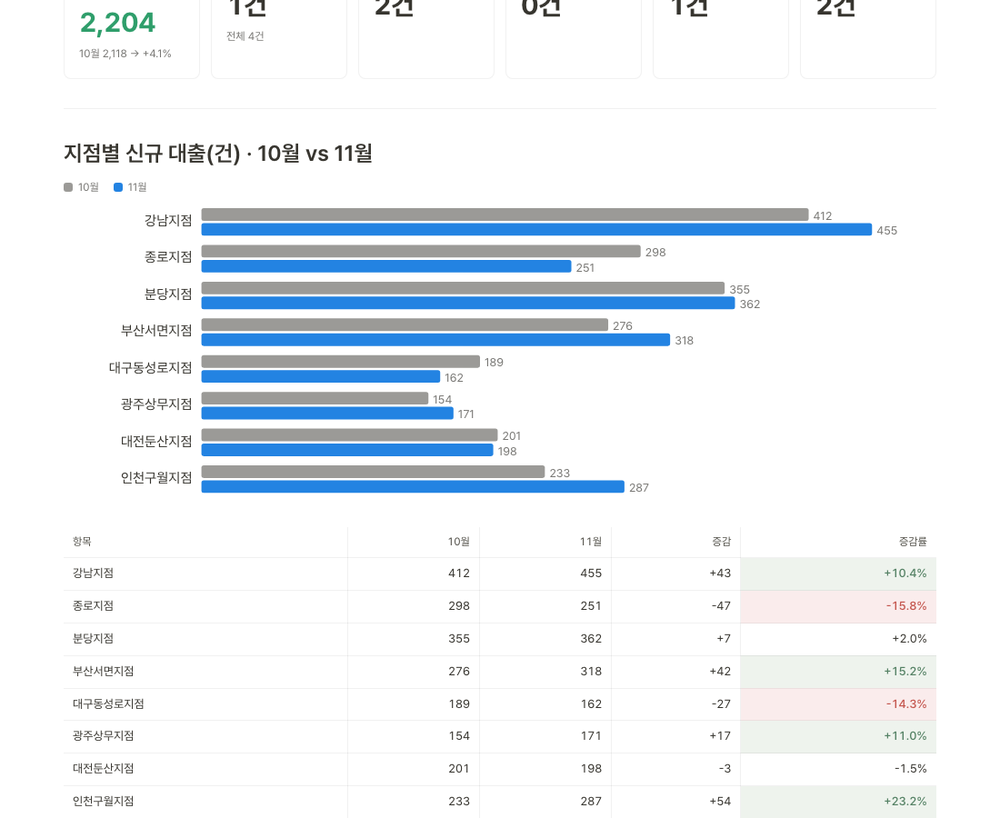

# 업무 대시보드 템플릿 (노션 스타일)

HTML 파일 하나로 업무 대시보드를 만듭니다. 지점별 실적 비교, 업무 현황, 이슈·지원 요청, 다음 주 일정이 한 화면에 나옵니다. 디자인은 노션 스타일 디자인 시스템 **Folio**의 토큰을 그대로 씁니다. 숫자는 모두 가상입니다.



## 받는 법

둘 중 편한 쪽을 고릅니다.

1. **ZIP으로 받기**: 이 화면 오른쪽 위 초록색 **Code** → **Download ZIP**. 압축을 풀면 `dashboard.html`이 있습니다. GitHub 계정이 없어도 됩니다.
2. **내 저장소로 복제하기**: 이 화면 오른쪽 위 **Use this template** → **Create a new repository**. 내 계정에 같은 파일이 생깁니다.

## 쓰는 법

**1. 열어 보기.** `dashboard.html`을 더블클릭하면 브라우저에서 열립니다. 설치할 것은 없습니다.

**2. 내 숫자로 바꾸기.** 화면의 모든 숫자는 파일 맨 위 `DATA` 한 곳에 모여 있습니다. 직접 고치지 않고 Claude에게 시킵니다.

```text
dashboard.html의 DATA를 아래 내용으로 바꿔줘. 화면 구조와 디자인은 바꾸지 마.
(지점 실적 표, 업무 현황 표 등을 여기에 붙여 넣기)
```

**3. 아티팩트로 올리기.** Claude 데스크톱 앱 Code 탭에서 이 폴더를 열고 보냅니다. 올린 아티팩트는 기본으로 나만 볼 수 있습니다.

```text
dashboard.html을 아티팩트로 올려줘
```

## 노션 스타일로 더 만들기

새 화면을 덧붙일 때는 `CLAUDE.md`의 규칙을 Claude가 따릅니다. 색, 간격, 글자 크기, 모서리는 `css/tokens.css`의 `--fl-*` 토큰만 씁니다. 버튼·카드·표·태그·콜아웃 같은 부품은 `css/components.css`에 있습니다. 새 색을 직접 정하지 않으면 대시보드와 같은 노션 분위기가 이어집니다.

## 파일

| 파일 | 설명 |
|---|---|
| `dashboard.html` | 완성본. 이 파일 하나면 됩니다 |
| `CLAUDE.md` | Claude가 이 저장소에서 지킬 규칙 |
| `css/tokens.css` | Folio 토큰(정본 복사본). 고치지 않습니다 |
| `css/components.css` | Folio 컴포넌트(정본 복사본). 참고용입니다 |
| `src/dashboard.src.html`, `scripts/build.mjs` | 완성본을 만드는 원본과 스크립트 |

토큰이나 화면 틀을 고쳤다면 `node scripts/build.mjs`로 `dashboard.html`을 다시 만듭니다. `css/` 아래 파일은 정본 저장소(`notion-design-system`)에서 복사해 오고 여기서 고치지 않습니다.
